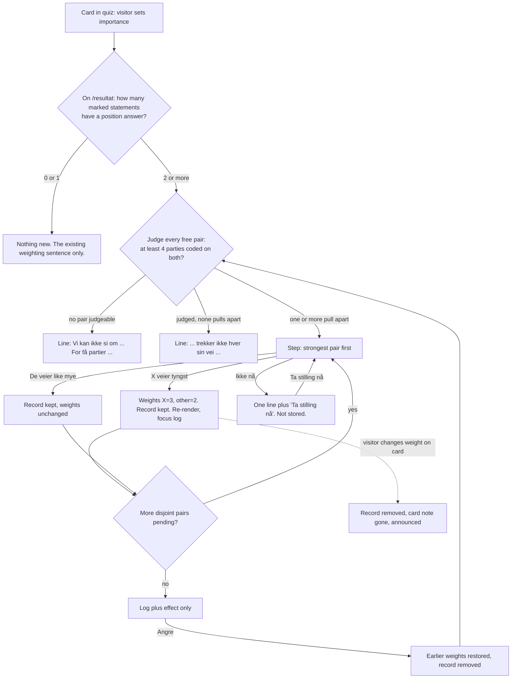

# Avveining: when two important statements pull apart

## The decision this supports

When two statements the visitor marked as important pull the party match in
opposite directions, the visitor decides which one weighs more, instead of
the weighted mean silently splitting the difference.

## What I read and measured first

- Code read: `quiz.js`, `scoring.js`, `analyse.js`, `style.css` (+ `quiz-flow.css`,
  `analyse.css`), `index.html.tmpl`, `resultat.html.tmpl`,
  `docs/programme-statement-join-analysis.md`, both token guards and the network guard.
- Data: the payload served on https://ektevalgomat.no on 2026-10-13 (snapshot
  2026-10-12, 60 statements, 9 parties, 12 dimensions).
- Live page, headless Chrome at 1280 and 375 px.
- Base rate, measured on the real payload: for a visitor who answers "Sterkt
  enig" everywhere, **594 of 1 653** judgeable statement pairs (36 %) pull apart
  at the threshold proposed below. **117** pairs cannot be judged, exactly the
  pairs that involve 60 or 61 (no party coded). So this step will come up for
  real visitors, and the "cannot tell" state is real too.

### Defects found on the way (live today, outside the step, but they block it)

| # | Defect | Evidence | Why it blocks the step |
|---|---|---|---|
| D1 | The importance row never shows the new state. Clicking "Viktig" saves `{"utsagn-01":2}`, but `aria-pressed` stays on "Vanlig". | Live, utsagn 1. `markWeight` looks up `statement-utsagn-01`, the card id is `utsagn-1`. | The step reads weights. If visitors cannot see a weight they set, they set it again or not at all. One-line fix, in the prototype. |
| D2 | "Hvorfor dette resultatet?" ignores weights. The headline says Senterpartiet (weighted), the panel says "partiet på topp (Venstre)" and "Standardresultatet vekter hvert utsagn likt". | Live, same answers and weights: headline Sp 75 %, panel top V. | Two top parties on one page. Any weighting, and so any trade-off, makes the panel explain a number the page is not showing. Fixed in the prototype. |
| D3 | A tie at the top is broken by payload order. The headline names one party when two share the top number. | Overlay with unchanged headline code: "mest på linje med Senterpartiet (73%)" with V also 73 %, and Sp = R = 75 % in another state. | Trade-offs move numbers by a few points, so ties get more common. The step's own copy handles ties. The headline needs the same rule (owner, see open question 7). |
| D4 | The panel sits below all 60 statement sections and the delete control. | Live screenshot `shots/live-resultat-panel-1280.png`. | The explanation is a long scroll from the number it explains. So the trade-off log must live next to the number, not in the panel. |

## The five recommendations

1. **Where it lives: on `/resultat`, inside "Hvem er du mest på linje med?",
   between the sentence that explains weighting and the bar chart.** The same
   renderer serves the ephemeral inline result, so that mode gets it for free.
   Not mid-quiz: to explain the conflict, the step has to know which parties sit
   near you on each statement. Shown while you are still answering, that primes
   the next answers. The site removed theme headings over the question for
   exactly this reason. `quiz.js` owns the step and re-renders the root.
   `analyse.js` listens to one DOM event and re-renders itself.
2. **What an answer changes: weights only (chosen = 3, other = 2), plus a
   separate record that holds the weights from before.** The score reads
   weights and nothing else, so `pct()` and the mean stay as they are. The
   record exists to list and undo the decision. A "priority" the score reads on
   its own is rejected: the card would say "Svært viktig" while the statement
   counts 2, and the card would lie. Dropping the other statement to "Vanlig" is
   rejected too: the visitor marked it important, and a ranking is not an erasure.
3. **How many: one per conflicting pair, with disjoint pairs, so each statement
   sits in at most one trade-off. Strongest conflict first, one at a time, and
   the visitor can stop at any point.** Disjoint pairs are what keep a
   weights-only model consistent: "30 over 55", then "55 over 11", would quietly
   set 55 back to 3 and undo the first decision. No conflict means no question,
   but the step says so in one muted line. A stated absence beats silence, which
   reads as "the feature did not run".
4. **The wording is a ranking: "Hvilket av disse veier tyngst for deg?"** A
   sacrifice ("velge bort") would be false, because nothing is dropped and the
   other statement still counts 2. The copy says exactly what happens, in the
   site's voice: plain du-form, short sentences, the limit stated.
5. **Undo and legibility: an "Avveiningene dine" log in the same box. Each line
   has "Angre", which restores the exact earlier weights. Below it, the effect:
   the top party with and without the trade-offs, and every party whose number
   moved.** A small note on the statement card in the quiz says the weight was
   set by a trade-off, and changing the weight by hand removes the trade-off.
   The panel uses the same weights as the headline (D2).

## The flow



1. **Entry.** The visitor sets "Viktig" or "Svært viktig" on statement cards in
   the quiz. Nothing about trade-offs appears in the quiz.
2. **Arrive on `/resultat`** (or "Se resultatet her" in ephemeral mode). The
   step runs `EkteAvveining.plan(data, answers, weights, records)`.
   - Fewer than 2 marked statements with a position answer: show nothing new.
     No line advertising the feature either, so nobody marks importance just to
     unlock a step.
   - 2 or more: judge every pair of free statements (not already in a record).
3. **Judge a pair.** Take the parties with a coded position on both. Fewer than
   4: "unknown". Otherwise take the Pearson correlation of the visitor's
   per-party match on the two. At r ≤ −0.3 the pair pulls apart.
   - Nothing judgeable: line Z1. Judged, nothing pulls apart: line Z2, plus a
     clause naming any unknown pairs.
4. **Ask.** Show the strongest pair (lowest r). Options appear in statement
   number order, never ordered by which one helps the current top party. The
   choices carry no party names. The party evidence sits behind "Hvorfor spør vi
   om dette?", so the visitor decides on the statements, not on a party they
   would like to see win. The step shows no preview of the effect (that would
   be a tuning dial). The effect appears after the choice, with undo.
5. **Decide.**
   - "Utsagn N veier tyngst": winner 3, other 2, record `{a, b, valg, foer}` saved.
   - "De veier like mye": record saved, weights unchanged. The pair is settled
     and not asked again.
   - "Ikke nå": hidden for this page view only. One line stays: "Du har en
     avveining du ikke har tatt stilling til. [Ta stilling nå]". Not stored.
6. **After a decision**, everything re-renders: headline, step box, bars and
   the panel (via `ektevalgomat:vekt-endret`, keeping its open or shut state).
   Focus moves to the next pending step's heading if there is one, otherwise to
   "Avveiningene dine". A live-region announcement says what happened.
7. **Undo**: "Angre" restores both earlier weights exactly, removes the record,
   and the pair becomes askable again.
8. **Manual change**: setting the weight on a card in the quiz for a statement
   in a record removes that record. The visitor's hand-set weight wins. The
   announcement says the trade-off was removed.
9. **"Slett alle svar"** clears the trade-off key with the answers and weights.

## State table

| State | Shown | Allowed | Must not imply |
|---|---|---|---|
| 0 or 1 statement marked | Existing weighting sentence (if 1). No step. | Nothing new. | That a trade-off exists or is waiting. |
| ≥2 marked, none judgeable (fewer than 4 parties coded on both, for every pair) | Line Z1, muted. | Nothing. | That the statements agree. We cannot tell, and say so. |
| ≥2 marked, judged, none pulls apart | Line Z2, muted. Clause for any unknown pairs. | Nothing. | That the feature failed, or that the visitor's priorities are "consistent" in a moral sense. |
| Conflict pending, first ask | Step box: heading, lede, question, two identical option cards, effect promise, "De veier like mye", "Ikke nå", collapsed evidence. Eyebrow "Avveining n av m" only when m > 1. | Choose either, call them equal, defer, open evidence. | That one option is the right one (same style, number order), or which party each choice helps. |
| Evidence open | "7 av 9 partier har en posisjon med kilde på begge ...", then a table of party, % on each. | Read, close. | A verdict. Numbers in plain text, no colour per cell. |
| Decided, more pending | Log, effect, then the next step below a rule. | Undo any line, continue. | That the next pair depends on the last choice (it does not: pairs are disjoint). |
| All decided | Log plus effect only. | Undo. | That the result is now "true". The existing caveats stay above. |
| "Ikke nå" | One line plus "Ta stilling nå". | Resume. | That the visitor answered. Nothing is stored. |
| Top party tied after a decision | "Med avveiningene ligger X og Y likt øverst, med N %." | Same as decided. | That X leads. Payload order never picks a winner. |
| A statement in a record later answered "Vet ikke" | Log line plus "Du har senere svart «Vet ikke / hopp over» på et av dem, så det teller ikke i samsvaret." | Undo. | That the trade-off still moves the result through that statement. |
| Weight changed by hand on a card | Card note disappears. Record gone. Announcement. | Nothing to undo. | That the old trade-off still applies. |
| Ephemeral session | Same as above, nothing written to localStorage. | Same. | That the decision will survive a reload. |
| Snapshot changed | Records dropped with answers and weights (same `snapshot_date` rule). | Start again. | That old trade-offs refer to the new statement texts. |

## Visual spec

All in `style.css`, since both `/` (inline result) and `/resultat` load it.
`.quiz-btn` lives in `quiz-flow.css`, which `/resultat` does not load, so the
step has its own button classes. Colours and sizes come from tokens only. Both
token guards and the network guard pass on the overlay, and each was
mutation-checked to fail on a raw hex, a raw rem and a `fetch(` in the new files.

| Element | Class | Tokens |
|---|---|---|
| Box | `section.avveining#avveining` (`aria-labelledby="avveining-heading"`) | bg `--surface`, border 1px `--line`, left rule 3px `--accent`, padding `--sp-5` `--sp-6`, margin `--sp-6` 0 `--sp-7`. Mobile padding `--sp-5` `--sp-4`. |
| Eyebrow (only m > 1) | `.avveining-teller` | `--fs-2xs`, `--muted`, uppercase, 0.05em tracking (same as `.section-sublabel`) |
| Heading | `h3.avveining-title`, `tabindex=-1` | `--fs-xl`, serif from `h3` |
| Lede | `p.lede` | existing |
| Question | `.avveining-spm` | 600, margin `--sp-5` 0 `--sp-3` |
| Options | `.avveining-valg` > `.avveining-alt` ×2 | grid 1fr 1fr, gap `--sp-4`. Mobile: 1 column. Alt: bg `--card`, border `--line`, padding `--sp-5`. |
| Option meta | `.avveining-alt-nr` | `--fs-xs`, `--muted`: "Utsagn 30 · Du svarte: Sterkt enig" |
| Option text | `.avveining-alt-tekst#avv-tekst-N` | `--fs-md`, 600 |
| Choose | `button.avveining-velg`, `aria-describedby="avv-tekst-N"` | border `--accent`, text `--accent-strong` (10.4:1 on card), bg `--card`, hover `--accent-soft`, padding `--sp-5`. Measured 49 px tall. Both identical. |
| Promise | `.avveining-effektlofte` | `--fs-sm`, `--muted` |
| Secondary | `button.avveining-sekundaer` in `.avveining-rad` | border `--muted` (6.5:1, not `--line` at 1.34:1), text `--accent`, padding `--sp-5`. Measured 48 px. |
| Evidence | `details.disclosure.avveining-hvorfor` > `table.party-overview.avveining-bevis` | summary `--accent`, `--fs-md`. Table reuses `.party-overview`, `th` `--fs-xs` `--muted`. |
| Log | `ul.avveining-logg` > `li.avveining-logg-rad` | flex wrap, border-bottom `--line`, text `--fs-md` |
| Undo | `button.avveining-angre`, `aria-label="Angre avveiningen mellom utsagn A og B"` | as secondary |
| Effect | `.avveining-effekt` | 600, `--fs-md` |
| Moved list | `.avveining-flytt` | `--fs-sm`, `--muted`. **Spec, not yet in prototype:** wrap each "V 71 → 69 %" in `span.avveining-flytt-del { white-space: nowrap }`. On 375 px it currently breaks after the arrow. |
| No-conflict line | `p.lede.avveining-ingen` | `--fs-md` |
| Card note | `p.weight-note#weight-note-N` inside `.weight` | `--fs-xs`, `--muted`, full row |

The arrow in the moved list is text content (U+2192), not decoration, so it is
not `aria-hidden`. Screen readers say "pil høyre", which is acceptable here. The
alternative is "fra 71 til 69 %", recommended if the owner prefers it (open
question 8).

## The copy

All strings as rendered in the prototype. N, X and Y are filled in.

| Where | String |
|---|---|
| Eyebrow (m > 1) | `Avveining 1 av 2` |
| Heading | `To viktige utsagn trekker hver sin vei` |
| Lede | `Du har merket begge som svært viktige. Partiene som står nærmest deg på det ene, står langt fra deg på det andre. Da deler snittet forskjellen mellom dem. Du kan velge hvilket som skal veie tyngst.` (`viktige` instead of `svært viktige` unless both are 3) |
| Question | `Hvilket av disse veier tyngst for deg?` |
| Option meta | `Utsagn 30 · Du svarte: Sterkt enig` |
| Choose | `Utsagn 30 veier tyngst` |
| Promise | `Det du velger, teller 3 i snittet, det andre 2. Svarene dine endres ikke, og du kan angre.` |
| Equal | `De veier like mye` |
| Defer | `Ikke nå` |
| Deferred line | `Du har en avveining du ikke har tatt stilling til.` / `Du har 2 avveininger du ikke har tatt stilling til.` + `Ta stilling nå` |
| Evidence summary | `Hvorfor spør vi om dette?` |
| Evidence text | `7 av 9 partier har en posisjon med kilde på begge utsagnene. Samsvaret ditt med dem på det ene utsagnet går motsatt vei av samsvaret på det andre.` |
| Evidence columns | `Parti` · `Utsagn 30` · `Utsagn 55`, cells `25 % samsvar` |
| Log heading | `Avveiningene dine` |
| Log line, chosen | `Utsagn 30 (Lovfeste avisdistribusjon i distrikt) veier tyngst, foran utsagn 55 (Samlet skatte- og avgiftsnivå senkes). Teller 3 mot 2.` |
| Log line, equal | `Utsagn 30 og utsagn 55 veier like mye. Vektene er ikke endret.` |
| Log note, skipped later | `Du har senere svart «Vet ikke / hopp over» på et av dem, så det teller ikke i samsvaret.` |
| Undo | `Angre` |
| Effect, same top | `Øverst ligger fortsatt Senterpartiet, 75 % uten avveiningene og 75 % med dem.` |
| Effect, new top | `Uten avveiningene ville du vært mest på linje med X (N %). Med dem er det Y (M %).` |
| Effect, tie | `Med avveiningene ligger Senterpartiet og Venstre likt øverst, med 73 %. Uten dem lå Senterpartiet øverst (75 %).` |
| Moved | `Slik flyttet tallene seg: R 66 → 70 %, V 71 → 69 %, … Uendret: Sp, MDG.` / `Ingen partier fikk et annet tall.` |
| No conflict (Z2) | `De 2 viktige utsagnene dine trekker ikke hver sin vei, så det er ingenting å avveie.` (+ ` For 1 av parene har for få partier en posisjon med kilde på begge til at vi kan si det.`) |
| Cannot tell (Z1) | `Vi kan ikke si om de viktige utsagnene dine trekker hver sin vei. For få partier har en posisjon med kilde på begge.` |
| Card note | `Satt i en avveining mot utsagn 55 på resultatsiden. Endrer du vekten her, fjernes avveiningen.` |
| Announce, chosen | `Utsagn 30 veier nå tyngst. Resultatet er regnet ut på nytt.` |
| Announce, equal | `Begge veier like mye. Vektene er ikke endret.` |
| Announce, undo | `Avveiningen er angret. Vektene er tilbake til det du satte selv.` |
| Announce, manual | `Utsagn 30: vekt satt til Viktig. Avveiningen med dette utsagnet er fjernet.` |
| Panel, weighted | `Resultatet ditt bruker vektene du har satt. Her får i stedet hvert tema samme vekt, …` (replaces `Standardresultatet vekter hvert utsagn likt.` when any weight is set) |

## Data model

```
localStorage["ektevalgomat-avveining-v1"] =
  { snapshot_date, avveininger: [ { a: "utsagn-30", b: "utsagn-55",
                                    valg: "a" | "b" | "lik",
                                    foer: { a: 3, b: 3 } } ] }
```

Pure functions in `web/static/js/avveining.js` (UMD, like
`scoring.js`): `plan`, `judgePair`, `decide`, `undo`, `dropOnManualChange`,
`weightsWithout`. The score never reads this key. Lift the module as is. The
`quiz.js` side of the overlay is a prototype shortcut: `aggregateWith` swaps
the module-level `weights`, and `analyse.js` keeps the weights in a module
variable. Real code should pass weights as a parameter.

Tests the builder must add (node runners, `tools/*.test.js`):
- the panel's `baseTop` equals the headline's top for a weighted fixture (D2),
- `decide` then `undo` returns the exact input weights, including absent keys,
- pending pairs are disjoint, and a "lik" record settles its pair,
- a pair with 3 shared parties is `unknown`, never `no-conflict`,
- a tie at the top is named as a tie (D3), in the step and in the headline.

## Prototype

On the unmerged branch `design/avveining`, `docs/design/prototypes/avveining/run.sh`
copies the app to scratch, applies `overlay.patch` (5 files) and
`avveining.js`, runs `go test ./web/` (the token and network gates) and serves
on `:8091`. `states.playwright.js` seeds the scenario and walks every state.
Verified: the script rebuilds the overlay from a clean copy, and every state
renders with zero console errors under the real CSP.

**The data:** the statements, party positions and match numbers are real
(payload of 2026-10-12). **The visitor is invented:** 12 answers, with 30, 55
"Svært viktig" and 11 "Viktig". No placeholder text.

The prototype's screenshots (ask on desktop and at 375 px, evidence open, decided,
tie, no conflict, card note) are on the unmerged branch `design/avveining`. The
shipped build was re-captured at both widths; see "Som bygget".

## Open questions, with my recommendation

1. **Conflict threshold.** Recommend r ≤ −0.3 with at least 4 shared parties.
   It catches 36 % of pairs for an always-agree visitor. Stricter (−0.5) asks
   rarely and misses real splits. Looser reads noise as conflict. Revisit once
   the coded share grows.
2. **The 3 : 2 ratio.** Recommend keeping it. It stays inside the existing 1..3
   scale, so no new number needs explaining, and it is bounded: a trade-off can
   never make one statement outweigh the rest of the quiz.
3. **Does "Viktig" (2) qualify, or only "Svært viktig" (3)?** Recommend both.
   Marking a statement as important at all is the signal.
4. **Undo lets a visitor try both and keep the better party.** Accept it.
   Removing undo would make the result unauditable, which is worse. Not
   previewing the effect, and keeping party names off the choice, is the
   proportionate guard.
5. **A pointer in the quiz's "Se over svarene dine" step?** Recommend no for
   now. It would have to say a conflict exists, which is a hint about results
   during the quiz.
6. **Persist "Ikke nå"?** Recommend no. A stored deferral is a decision the
   visitor never made.
7. **The headline tie (D3) is pre-existing.** Recommend fixing it with the
   step: name every party on the top number. Owner call, since it changes
   shipped copy.
8. **Arrow or words in the moved list.** Recommend the arrow, for scan speed.
   Use "fra 71 til 69 %" if screen-reader testing finds the arrow noisy.

## Ekstern gjennomgang: hva som står

Two external reviews (v1 relayed by the manager, v2 pasted by the owner).
Neither reviewer could read the repo, and v1 never saw the rendered quiz. I
checked each item against the code and the live page on 2026-10-13, empty
quiz, 1280 and 375 px.

### Holds, verified

| Finding | Evidence | Owner of the fix | Recommendation |
|---|---|---|---|
| "58 utsagn i alt" beside "60 utsagn" | Both on the live landing page. 58 = 60 − 2 statements outside the dimensions (`coreStatementBuilt`). The number is right, the words "i alt" are wrong. | Copy | `De elleve dimensjonene rommer 58 av de 60 utsagnene. De to siste står utenfor dimensjonene.` |
| "(11)" vs 12 dimensions | 11 dimensions plus the "Tillegg (utenfor de 42)" bucket. The intro already says so. | None | Correct as is. |
| `/utsagn/43` is a bare 404 | Go's default plain text "404 page not found", no header, no way back. | Code | Themed 404 for missing statement numbers: `Det finnes ikke et utsagn 43.` + back link. Why 43 is missing is owner knowledge, so I don't write a reason. |
| Arrows not `aria-hidden` | All five (`↓`, four `→`) are bare text in the link. | Code | Wrap in `<span aria-hidden="true">`. Whether to keep them is taste. |
| N1, unclear first step | "Neste" is enabled and filled purple before any answer. "Start valgomaten ↓" is filled purple. "Vanlig" starts pressed and is the only purple text in the card. The answer buttons are grey outlines. | Design | Matters for this flow: the importance row should read as a default, quieter than the scale. Pressed "Vanlig" in `--ink`, accent only on "Viktig" and "Svært viktig". |
| N3, settings above the question | First answer button at y = 760 of 900 on desktop, 1011 on 375 px (below the fold). | Design | Move "Innstillinger" below the card or into a disclosure. |
| N4, line length | Intro about 102 characters per line at 1280. | CSS | Add a `--measure: 68ch` token, apply to `.lede` and prose. |
| N6, touch targets | Answer buttons 36 px (41 on mobile), importance pills 30 px, widths 116 to 161 px. | CSS | 44 px minimum through padding tokens, equal segments. The new step's buttons measure 48 and 49 px. |
| N10, two words for one thing | "Spørsmål 1 av 60" above "Utsagn 1". | Copy | Use "Utsagn" in both. |
| N2, nine vs eleven themes | True. Three statement dimensions have zero programme points (join analysis). | Copy | One line on `/program`: the two added themes have no programme points coded, so their sources are on each statement page. Don't add themes without data. |

### Already solved, or false

| Claim | Why it does not stand |
|---|---|
| "Kjerneverdiene" is the largest block, "0 av N besvart" eleven times on first view | Moved into a collapsed `<details>` on 2026-10-12. Live: `open = false`, first view shows only the intro card. The rows are there, but only after a click. |
| "Maturity L0, no design system" | `:root` holds the colour tokens plus 9 type and 9 space steps, and two Go guards enforce them. |
| "Add a gloss field" | `practical_stakes_enig/uenig` exist on all 60, rendered as "Hva betyr et svar i praksis?". |
| N8, contrast | Every text token passes AA on every surface. The weakest is `--muted` on `--accent-soft`, 5.58:1. The real gap is non-text: `--line` borders are 1.34:1. Not a strict 1.4.11 failure, because text labels identify the buttons, but the new step uses `--muted` borders for that reason. |
| Focus | `:focus-visible` is a 2px `--accent` outline, 6.28:1 on `--bg`. The step moves focus to a `tabindex=-1` heading after every decision. |
| Heading order | Landing: h1, h2, h2, h3 (inside the disclosure), h2. Result: h1, h2, h2, h3. No skipped level. The step adds an h3 under the summary's h2. |
| "Results page unverifiable" | Verified here, and it surfaced D2 and D3, which neither review could see. |

### Data, for the owner, not for design

- Compound, negated or jargon-heavy statements (ACER, NTS, OTP, ETS2,
  hjemmelslengde, KOMBIT). The positions are sourced to the legislative text, so
  rewording is an editorial call per statement. Recommend a triage pass that
  flags every statement with a negation or an unexplained acronym in `text`,
  and checks whether `practical_stakes` defines the term.
- Budsjett jargon (strukturelt oljekorrigert, pst.poeng, Gul bok, kap./post).

### Partly stands, a separate design task

- **Cream identity (v1 #16, v2 N13).** The tokens are as described, and the
  surface is common. But the palette is deliberate (violet chosen to sit
  outside every party's hue, red and green barred as verdicts), and contrast is
  sound. The good idea is the reviewer's other one: make the citation the
  identity. Use the `[e]` bracket as the source marker on each statement, and
  make one statement with its source the landing hero. Recommend it as its own
  brief, not folded into this step.

### Not checked

Budsjett N5 and N9, Partiprogram N7 and N12, header alignment N11. These are
outside this flow and I didn't verify them. They are leads, not findings.

### Where the flow begins

This flow begins at the importance row on a statement card in the quiz, and
resolves on `/resultat`. The landing page is upstream. N1 and N3 decide whether
visitors reach the importance row at all and use it as meant, so they are the
first fixes to make before this step ships.

## Tredje gjennomgang (informasjonsarkitektur): hva som står

A third external review proposes Understand / Compare / Verify as the site's
spine and argues the site reads like a document archive. Like the other two, it
never saw the repo. I checked every count and data claim it makes against the
content files, the live pages and, for the votes, Stortinget's own open data.

### Item 1: "same case, different majorities" holds, and it is verified at the source

| Claim | Dataset | Primary source (data.stortinget.no, fetched 2026-10-13) |
|---|---|---|
| Utsagn 38 and 39 are two forslag in one case | Both cite Dokument 8:266 S, Innst. 392 S (evidence 161, 181) | `voteringsforslag`: 28068 = "Forslag nr. 1 fra FrP, SV, R, MDG, KrF", 28067 = "Forslag nr. 2 fra SV, Sp, R, MDG, KrF". Both statement texts match the forslag texts **verbatim**. |
| 38 rejected 48–53 | 161: FrP 29, SV 5, R 5, MDG 5, KrF 4 for. Ap 32, H 14, Sp 5, V 2 mot | Roll call 28068: identical, party by party. |
| 39 rejected 26–74 | 181: SV 5, Sp 5, R 5, MDG 5, KrF 4, V 2 for. Ap 31, FrP 29, H 14 mot | Roll call 28067: identical. |
| FrP for 38, against 39. Sp and V the opposite | Positions +2/−1 (FrP), −1/+2 (Sp), −1/+1 (V) | Confirmed by both roll calls. |
| (missed by the reviewer) Something **passed** | 161 mentions romertall I and II, 57–43 | Roll call 28069: 57–43, and Ap split 4 for, 27 mot. A comparison that shows only the two rejections would imply the case produced nothing. |
| Reasons for the split | 162 (FrP, `partiets_begrunnelse`, verbatim merknad on the Finnish model). 169 (Sp, `uklart`: "Ingen Sp-spesifikk begrunnelse"). 189 (FrP on 39, `uklart`, coded from the vote alone) | Not in the API. The dataset itself says the missing reasons must not be presented as fact. |

**So it is buildable, and for this case it is a design task, not research.**
Positions, tallies, forslag texts and documented reasons all exist and agree
with the source. The sketch below was generated by
`prototypes/samme-sak/build.py` (on the unmerged branch `design/avveining`), straight
from the three roll-call files saved beside it. No number in it is typed by hand.

The sketch's screenshots (desktop and 375 px) are on the same branch.

Design notes from rendering it:
- **Parties are rows, votes are columns.** My first version had it the other
  way round. On desktop it clipped the V column (one of the three parties the
  headline names), and on 375 px it showed only Ap. Transposed, all nine fit at
  309 px in a 341 px card, with no scroll region.
- For, mot and delt carry a word plus a shape (● ○ ◐), and both sides are
  `--ink`. No colour per side, so no verdict colour.
- The switchers get a text label ("Byttet side mellom A og B"), not a highlight.
- The headcount sits beside every result ("101 av 169 stemte"). About 100 of
  169 were present, and a tally without its sample reads as the whole Storting.
- Forslag text is quoted in full, with Stortinget's own designation. The short
  labels A, B, C are mine and say so implicitly by being headings, not quotes.
  C's label ("Finsk modell og matavtaler") has no statement behind it, and the
  card says "Ikke et utsagn i valgomaten".
- "Hvorfor stemte de ulikt?" is collapsed and says only what is documented:
  FrP and KrF's merknad for B, and no documented reason for FrP's no to A or
  Sp's no to B. "Vi gjetter ikke på en."
- Placement: on `/utsagn/38` and `/utsagn/39`, under the chain, as "Samme sak i
  Stortinget". It is a property of the case, so it should not live inside the
  quiz.

**Generalising it is not free.** Grouping evidence by the innstilling in
`source_name` finds **12 innstillinger shared by two or more statements,
covering 31 of 60 statements**. But:
- The case key exists only as free text (`source_name`, `claim_action`). There
  is no `sak` or `votering_id` field in `types.go`. Grouping on parsed prose is
  the same trap the join analysis documented for programme links.
- Party tallies live in `claim_action` prose. 47 of 60 statements cite at least
  one `votering_id`, so the roll call can be fetched mechanically.
- **Orientation.** A naive "who switched side" count across the 12 cases is
  meaningless without knowing whether each statement is phrased *as* its
  forslag or as its negation. 14 and 15 (konsesjonsrunde vs moratorium) show 7
  "switchers" only because the statements mirror each other. 38/39 is clean
  because both texts are the forslag texts verbatim.

### The four buckets

**Buildable from data that exists today**
1. The 38/39 "Samme sak" block, as sketched.
2. Theme-view count. `/partier?tema=robusthet-adaptabilitet` shows "42 utvalgte
   programutsagn" for Ap beside the 5 points actually shown (live, all nine
   parties). Copy fix: `5 av 42 utvalgte programutsagn gjelder dette temaet.`
3. Dates that already exist, labelled apart: event date (`date`), "hentet"
   (`retrieved_at`, on every evidence item and programme), and the snapshot
   ("hendelser til og med"). Today only the snapshot pill is prominent.
4. A latent empty state on the theme view. If a party has no point in the
   chosen theme, the template renders its name and source line with nothing
   below. No such cell exists today (0 of 81), but the copy should be ready:
   `Vi har ikke valgt ut noe utdrag fra programmet om dette temaet. Det betyr ikke at partiet mangler politikk her.`
   The other empty states already hold this line ("Det er ikke en konklusjon om
   partiet", "står det tomt med vilje"). I found no place where it slipped.

**Needs a data step, mechanical, no judgement** (data plumbing, not design or research)
- Structured `sak` (innstilling id) and `votering_id` on evidence, and a loader
  test that fails when the prose and the field disagree.
- Per-party tallies imported from `data.stortinget.no` by `votering_id`,
  instead of hand-typed in prose.

**Needs editorial judgement, owner** (routed to you, not designed around)
- Orientation of each of the 31 shared-case statements against its forslag (as
  phrased, or negated). This must happen before any cross-case comparison.
- Programme points that are not promises. Verified examples: Rødt [19]
  "Totalberedskaps-kommisjonen fastslo i sin rapport at den sivile beredskapen
  er for dårlig …" (a reported finding) and FrP [24] "Strukturer … må derfor
  være robuste, forberedte og fleksible" (a principle). Recommend a
  `kind: løfte | vurdering | prinsipp` per point, set by hand.
- Truncated quotes. 107 of 316 quotes lack closing punctuation, mostly normal
  bullet items. But 9 end on a function word and look cut mid-sentence: 8 from
  KrF (e.g. [13] "… under ledelse av statsministeren, etter") and 1 from H [10].
  Re-check against the PDF and add "…" where a quote is deliberately shortened.
- Count meaning. MDG 63 and H 26 are confirmed (316 in total). They are
  selection counts. Recommend one sentence wherever a count shows: `Antallet
  sier hvor mange utdrag vi har valgt ut, ikke hvor mye partiet mener.`

**Research nobody has done**
- *Why* a party voted differently where it wrote nothing. The dataset already
  refuses to guess (189: "skal derfor ikke presenteres som fakta").
- An issue taxonomy that spans statements, programme points and cases ("how
  does Norway protect its food supply" = statements 38 and 39, the passed
  romertall I and II, and programme points such as Rødt [17] "Selvforsyning og
  beredskapslagre").
  The 12 dimensions are not that. Building it means editorial grouping
  decisions that need their own method.
- "Sitat kontrollert" and "posisjon vurdert" dates. No such events are recorded
  anywhere in the data. Showing those labels now would invent a process. It
  needs a review log first.

### Issue-first against party-first

It is a **smaller change than it looks for what exists, and a larger one for
what it implies.**
- Smaller: the site is already issue-first in two places. `/utsagn/N` is one
  issue with nine parties, and `/partier?tema=` puts all nine parties side by
  side per theme. Party-first is the *default* view of `/partier` (nine
  sections, 81 disclosures), not the model. Making the theme view the default,
  with party as a peer toggle, is a template and copy change.
- Larger: "issue" in the reviewer's sense is a question that spans several
  statements and cases. That unit does not exist in the data (see research
  above). Until it does, the honest issue-first unit is the statement and, where
  it exists, the case ("Samme sak").

### Rejected, with reasons

- **"Avoid nested accordions."** Measured on `/utsagn/38`, `/partier`, the theme
  view and `/metode`: zero nested `<details>`, depth 1 everywhere. The real
  problem is volume (81 flat disclosures on `/partier`), and the issue-first
  default fixes that. The statement page's theme disclosure stays: it is what
  keeps a theme-only point from reading as a claim about the statement.
- **Palette and typeface directions.** The reviewer says it did not sample the
  live site. The tokens are measured, and every text token passes AA (see
  above).
- **Folding the research atlas into this spec** (evidence trails, source
  highlighting, issue fingerprints, timelines, uncertainty lens). Kept as
  direction below, not scope.

### Direction, not scope

Worth keeping on the roadmap, in this order, each behind the data step it needs:
1. "Samme sak" on every shared case, after `sak` and `votering_id` are fields
   and orientation is checked.
2. Source highlighting: show the quoted forslag text inside the innstilling,
   once the quote-check log exists.
3. Timelines per case (forslag, innstilling, votering, oppfølging), once
   follow-up events are collected.
4. An issue view above statements, once the issue taxonomy has a method.

## Som bygget

Shipped as the step on `/resultat` and the inline result, from this design. What
differs from the prototype, and why. Anything not listed is as specified above.

**The core was verified a second way.** Every one of the 1,770 statement pairs on
the real payload (visitor answers "sterkt enig" everywhere) was judged by
`avveining.js` and by a separate Python implementation that shares no code with
it. They agree on all 1,770. The numbers in "What I read and measured first"
hold exactly: 594 pairs pull apart, 117 cannot be judged, 1,653 can; utsagn 30
and 55 conflict on 7 shared parties.

**Defects found on the way**

| | Status |
|---|---|
| D1 importance row never shows the new state | fixed in #115, before the step |
| D2 panel ignores weights | fixed in #117, before the step |
| D3 a tie at the top is broken by payload order | fixed here, for the headline and the effect line: `leaders()` in `scoring.js` names every party on the top number ("like mye på linje med X og Y (73% samsvar hver)") |
| D4 the panel sits below all 60 statement sections | not changed. The log and effect live next to the number, as specified, so the panel no longer has to be reached to understand a trade-off |

**Where the build departs from the prototype**

1. **Storage goes through `store.js`** (#119), not a bare `setItem`. Records are
   stored under the pair they decide between (`utsagn-30|utsagn-55`), so they get
   the same cross-tab merge, failed-write reporting and refresh rules as answers,
   and a record is dropped if either of its two statements is reworded.
2. **A record is only believed while its weights are in force**
   (`consistent()`). Weights and records are two separate writes, so two tabs
   deciding at once could otherwise leave the log naming a winner the score is not
   using. Checked at load and after every merge, which makes both self-correcting.
3. **A decision or undo always writes both weights.** Weights merge key by key, and
   only keys a tab changed are written. A decision that set a weight to the value
   that tab already held was invisible to the merge, so two stale tabs deciding the
   same pair ended with one tab's record and neither tab's weights. Found by a
   two-tab browser scenario that first "passed" with an empty log. Now the last
   decision wins cleanly.
4. **The explanation panel follows an event that carries the weights and answers**
   instead of re-reading storage. Re-reading would show it stale weights whenever a
   save had failed: D2 returning by the side door.
5. **Weights are a parameter** (`computeAggregate(list, weights)`), not swapped into
   a module variable to compute the "uten avveiningene" figure.
6. **Words, not an arrow, in the moved-numbers line** ("V fra 71 til 69 %"), the
   fallback recommended in open question 8. It reads the same to a sighted reader
   and a screen reader, and each part is one unit that never wraps inside itself.
7. **The card note is shown only when a trade-off set the weight.** A "like mye"
   decision changed no weight, so a note saying the weight was set by a trade-off
   would be false.
8. **Reading order matters.** A hand-set weight asks "is this statement in a
   record?" before saving, because saving re-checks the records and would
   otherwise already have dropped it. This was a bug in the first integration,
   caught by the browser scenario for it.

**Tests.** `tools/avveining.test.js` (67 checks, hand-computed fixtures, 14
mutations each caught), `tools/store.test.js` for the pair storage rules, and
`tools/browser/avveining.check.mjs` (real Chrome: every state in the table above,
persistence, two tabs, ephemeral mode, clear-all, a failed save, 375 px). Of eight
distinct mutations of the integration, seven were caught on the first run. The
eighth (storing a deferral) was an ineffective mutant that never persisted
anything; its meaningful form, "Ikke nå" recorded as a decision, is caught by four
checks.

**Open questions, as decided.** 1 (threshold -0.3, 4 shared parties): kept.
2 (3 : 2): kept. 3 (Viktig also qualifies): kept. 4 (undo may be used to try both):
accepted, with no preview and no party names on the choice. 5 (a pointer in the
quiz): no. 6 (persist "Ikke nå"): no. 7 (headline tie): done, as above.
8 (arrow or words): words.
